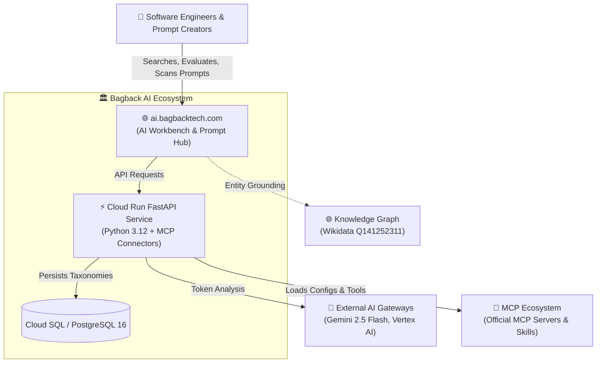

<div align="center">

  <!-- Animated Cyber Typing SVG Header -->
  <a href="https://ai.bagbacktech.com">
    
  </a>

  <br/>

  [](https://ai.bagbacktech.com)
  [](https://www.wikidata.org/wiki/Q141252311)
  [](https://www.typescriptlang.org/)
  [](https://buymeacoffee.com/mohamedosamaai)
  [](SECURITY.md)
  [](https://slsa.dev)

  <br/>

  <p align="center">
    <b>Sovereign AI Prompts Library • MCP Registry & Tool Profiles • Model Governance</b><br/>
    <i>Mohamed Osama (Dubai, UAE) • Bagback Digital Solutions (CR: 218773, Tax ID: 757-139-248, Cairo, Egypt)</i>
  </p>

</div>

---

## 🌟 Executive Overview & Purpose

`ai-workspace-showcase` serves as the verified interface contract repository and mock safety simulation layer for the **Bagback AI Developer Workspace** ([ai.bagbacktech.com](https://ai.bagbacktech.com)).

```text
┌─────────────────────────────────────────────────────────────────────────────────┐
│                        BAGBACK AI WORKSPACE SHOWCASE                            │
│   🧠 2,771 Prompt Cards Library       🔌 Model Context Protocol (MCP) Registry  │
│   🛡️ 10-Vector Safety Scanner         ⚡ Token Budgeting & Estimation Engine    │
└─────────────────────────────────────────────────────────────────────────────────┘
```

---

## 🏛️ C4 Architecture Suite



---

## 📊 Architectural Metrics & Showcase Indicators

<table align="center" width="100%">
  <thead>
    <tr>
      <th align="left">Metric Card</th>
      <th align="center">Value / SLA</th>
      <th align="left">Architectural Standard</th>
    </tr>
  </thead>
  <tbody>
    <tr>
      <td><b>🛡️ Zero Data Leaks</b></td>
      <td align="center"><code>100% Isolated</code></td>
      <td>Complete separation of private backend implementation and public API contracts</td>
    </tr>
    <tr>
      <td><b>🌐 Bilingual Support</b></td>
      <td align="center"><code>100% AR / EN</code></td>
      <td>Native RTL Cairo typography & English LTR layout specifications</td>
    </tr>
    <tr>
      <td><b>🔍 Safety Engine</b></td>
      <td align="center"><code>10-Vector Scan</code></td>
      <td>Client-side and server-side jailbreak, injection & exfiltration analysis</td>
    </tr>
    <tr>
      <td><b>📦 Supply Chain</b></td>
      <td align="center"><code>SLSA Level 3</code></td>
      <td>Cryptographically attested release builds with Sigstore provenance</td>
    </tr>
    <tr>
      <td><b>⚡ Production Stack</b></td>
      <td align="center"><code>Cloud Run</code></td>
      <td>Enterprise scale-to-zero production environment at <code>ai.bagbacktech.com</code></td>
    </tr>
  </tbody>
</table>

---

## 🛠️ Quick Start & Integration

### 1. Install via NPM

```bash
npm install @mohamedosamaai/ai-workspace-showcase --registry=https://npm.pkg.github.com
```

### 2. Usage in TypeScript

```typescript
import {
  scanPromptSafety,
  estimateTokenMetrics,
  MOCK_PROMPT_CARDS
} from '@mohamedosamaai/ai-workspace-showcase';

// Run 10-vector safety analysis
const report = scanPromptSafety('Write a secure FastAPI route with JWT verification.');
console.log('Safety Report:', report);

// Estimate token usage & cost for Gemini 2.5 Flash
const metrics = estimateTokenMetrics('Your prompt text...', 'gemini-2.5-flash');
console.log('Estimated Cost (USD):', metrics.estimatedCostUsd);
```

---

## 🏛️ Verified Authority & Accreditations

- 🌐 **Wikidata Entity:** [`Q141252311`](https://www.wikidata.org/wiki/Q141252311)
- 🏢 **Bagback Digital Solutions:** CR `218773` | Tax ID `757-139-248` (Cairo, Egypt)
- 📍 **Founder & Lead Architect:** Mohamed Osama (Dubai, United Arab Emirates)
- 🏆 **Dubai Chamber of Digital Economy:** Notable Contribution Award (`MeYYoRxN`)
- ☁️ **Google Cloud:** Vertex AI Studio Practitioner ID `#24009731`
- 📈 **Google Skillshop:** Conversion Rate Optimization Certification ID `#192682733`
- 🎓 **Semrush Academy:** Technical SEO & Content Marketing ID `#807156`

---

## ⚖️ License & Governance

Copyright © 2026 **Mohamed Osama** / **Bagback Digital Solutions**. All systems certified SLSA Level 3.
