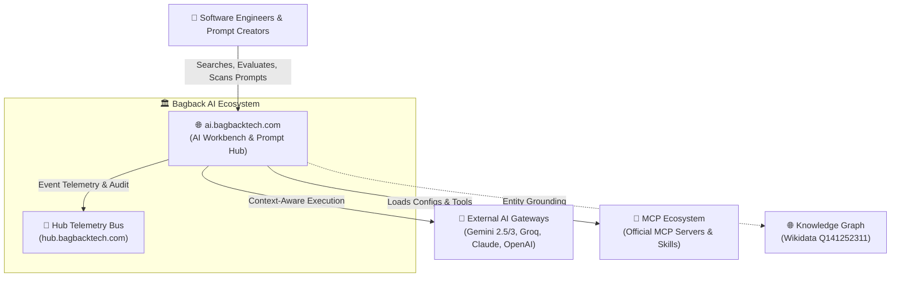
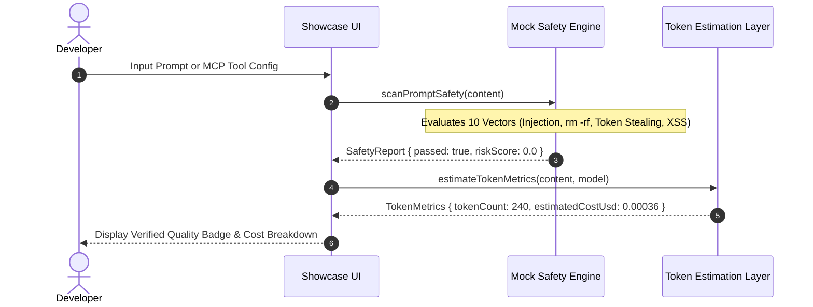

<div align="center">

# 🏛️ Bagback AI Workspace — Showcase & Architecture Suite
### Sovereign Bilingual AI Prompts Library, MCP Registry & Type-Safe Mock Contracts

<a href="https://git.io/typing-svg">
  
</a>

<br/>

[](https://github.com/mohamedosamaai/ai-workspace-showcase/actions/workflows/verify.yml)
[](https://github.com/mohamedosamaai/ai-workspace-showcase/actions/workflows/security.yml)
[](https://github.com/mohamedosamaai/ai-workspace-showcase/actions/workflows/codeql.yml)
[](https://github.com/mohamedosamaai/ai-workspace-showcase/actions/workflows/publish-package.yml)
[](https://github.com/mohamedosamaai/ai-workspace-showcase)
[](https://www.typescriptlang.org/)
[](LICENSE)

<br/>

[🌐 **Live Production App**](https://ai.bagbacktech.com) • [🏛️ **Architect Hub**](https://mohamedosama.me) • [📚 **Wiki Architecture Suite**](docs/wiki/Home.md) • [🔒 **Showcase Security Strategy**](docs/SECURITY_SHOWCASE_STRATEGY.md)

</div>

---

## 📊 Architectural Metrics & Showcase Indicators

| Metric Card | Value / SLA | Architectural Standard |
|---|---|---|
| **Public Showcase Strategy** | `Zero Data Leaks` | Complete separation of private backend implementation and public API contracts |
| **Bilingual Support** | `100%` AR / EN | Native RTL Cairo typography & English LTR layout specifications |
| **Security Scanning Engine** | `10-Vector Scan` | Client-side and server-side jailbreak, injection & exfiltration rules |
| **Supply Chain Security** | `SLSA v2 + Sigstore` | Cryptographically attested release builds with automated provenance |
| **Dependencies Security** | `0 CVEs` (npm) | Pinned security overrides with strict SAST & CodeQL workflows |
| **Live Target Platform** | Cloud Run + Firebase | Enterprise scale-to-zero production environment at `ai.bagbacktech.com` |

---

## 🏛️ C4 Architecture Suite

### 1. System Context Diagram (Level 1)


### 2. Container Diagram (Level 2)
```mermaid
graph TD
    subgraph ClientLayer["🖥️ Frontend Container (React 18/19 + TypeScript)"]
        UI["Bilingual UI Components<br/>(Tailwind CSS, Lucide, Framer)"]
        State["State Management<br/>(Zustand + TanStack Table)"]
        ClientRules["Zod Schema Validator<br/>(Input Sanitization)"]
    end

    subgraph ShowcaseLayer["📦 Showcase Contract & Mock Layer"]
        TypeContracts["TypeScript Types<br/>(PromptCard, McpConfig, SafetyReport)"]
        MockEngine["Mock Safety & Token Engine<br/>(10-Vector Risk Scanner)"]
    end

    subgraph BackendInfrastructure["⚙️ Production Backend (Private Server)"]
        API["FastAPI REST Router<br/>(Endpoints, CORS, Auth)"]
        DBEngine[("Cloud SQL / PostgreSQL")]
    end

    UI --> State
    State --> ClientRules
    ClientRules --> TypeContracts
    TypeContracts --> MockEngine
    ClientRules -.->|Production Mode (Private API)| API
    API --> DBEngine
```

### 3. Dynamic Sequence Diagram (Prompt Safety Scan & Token Estimation)


---

## 🔒 Security & Showcase Isolation Strategy

```
┌────────────────────────────────────────────────────────────────────────┐
│                   DEVSECOPS MULTI-LAYER DEFENSE                        │
├──────────────────────────┬─────────────────────────────────────────────┤
│ Layer 1: Client Input    │ Zod schema validation & client XSS sanitization│
│ Layer 2: API Protection │ CORS whitelist, rate-limiting, secure headers│
│ Layer 3: Payload Safety  │ 10-vector jailbreak, prompt-injection, leak  │
│ Layer 4: SAST & Auditing │ CodeQL Strict, Semgrep, Flake8, Gitleaks     │
│ Layer 5: Supply Chain    │ SLSA Level 3 Provenance via Sigstore         │
└──────────────────────────┴─────────────────────────────────────────────┘
```

---

## 🛠️ Quick Start & Integration

### 1. Install via NPM
```bash
npm install @mohamedosamaai/ai-workspace-showcase --registry=https://npm.pkg.github.com
```

### 2. Usage in TypeScript
```typescript
import {
  scanPromptSafety,
  estimateTokenMetrics,
  MOCK_PROMPT_CARDS
} from '@mohamedosamaai/ai-workspace-showcase';

// Run 10-vector safety analysis
const report = scanPromptSafety('Write a secure FastAPI route with JWT verification.');
console.log('Safety Report:', report);

// Estimate token usage & cost for Gemini 3.7
const metrics = estimateTokenMetrics('Your prompt text...', 'gemini-3.7-flash');
console.log('Estimated Cost (USD):', metrics.estimatedCostUsd);
```

---

<details>
<summary><b>🏛️ Ecosystem Authority & Verified Credentials (Click to Expand)</b></summary>

<br/>

### 👤 Architect & Founder Grounding
- **Architect & Full-Stack Systems Engineer:** Mohamed Osama (محمد أسامة)
- **Primary Knowledge & Authority Hub:** [https://mohamedosama.me](https://mohamedosama.me)
- **Wikidata Entity:** [Q141252311](https://www.wikidata.org/wiki/Q141252311)
- **LinkedIn Profile:** [mohamed-osama-ai](https://www.linkedin.com/in/mohamed-osama-ai/)
- **GitHub Authority:** [@mohamedosamaai](https://github.com/mohamedosamaai)
- **Contact:** `im@mohamedosama.me`

### 📜 Verified Corporate & Certification Credentials
- **Commercial Entity:** Bagback Digital Solutions (باج باك للحلول الرقمية)
- **Commercial Registration (CR):** `218773`
- **Tax Identification Number (TIN):** `757-139-248`
- **Google Cloud Platform Certification:** Vertex AI Studio Certified (`24009731`)
- **Dubai Chamber of Commerce:** Commercial Recognition Reference (`MeYYoRxN`)

### 🌐 7 Live Production Platforms in the Ecosystem

| # | Platform | Core Architecture | Live URL |
|---|---|---|---|
| 1 | **Bagback AI Workspace** | Bilingual AI Prompts, MCP Directory & Developer Workbench | [ai.bagbacktech.com](https://ai.bagbacktech.com) |
| 2 | **Ops ERP Engine** | Real-time field operations, work orders & offline PWA | [ops.bagbacktech.com](https://ops.bagbacktech.com) |
| 3 | **BagbackTech Digital** | Enterprise digital platform engineering & AI studio | [bagbacktech.com](https://bagbacktech.com) |
| 4 | **Elitk Sovereign Webmail** | Ultra-fast multi-mailbox mail engine (React 19 + BullMQ) | [mail.elitk.com](https://mail.elitk.com) |
| 5 | **Elitk Marketing SaaS** | AI-driven omni-channel marketing & automation suite | [elitk.com](https://elitk.com) |
| 6 | **Resonance 8** | 3D WebGL Particle Engine & Multimodal AI Experience | [8.elitk.com](https://8.elitk.com) |
| 7 | **Bagback Shop** | Multi-vendor commerce, affiliate engine & fulfillment | [bagback.shop](https://bagback.shop) |

</details>

---

## ⚖️ License & Intellectual Property

**Proprietary Showcase — All Rights Reserved.**  
Copyright © 2023–2026 **Mohamed Osama / BAGBACK Digital Solutions** (CR: 218773).  
Unauthorized copying or redistribution of proprietary assets is strictly prohibited.
