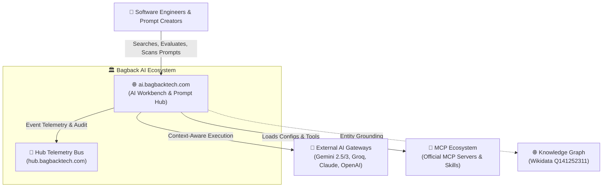
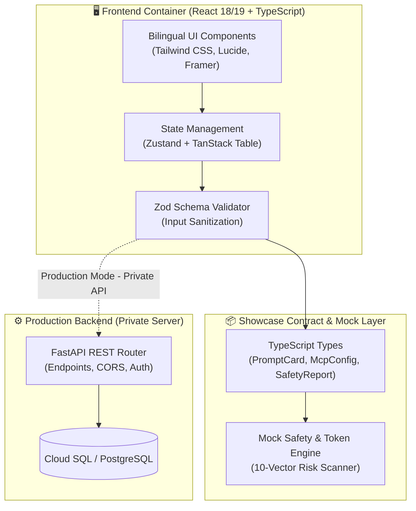
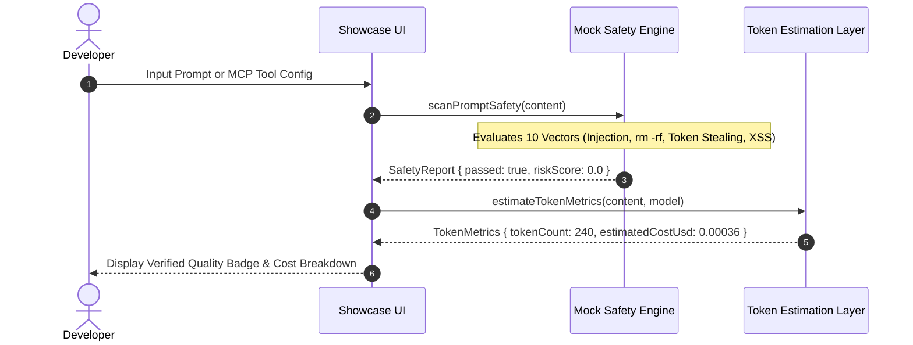

# 🏗️ C4 Architecture Specification: Bagback AI Workspace

## 1. Introduction
This document defines the structural architecture of the **Bagback AI Workspace** using the C4 model standard (Context, Container, Component, and Dynamic Sequence).

---

## 2. Level 1: System Context
The System Context diagram illustrates how external actors and AI ecosystems interact with the Bagback AI Workspace:

---

## 3. Level 2: Container Diagram
The Container diagram illustrates the high-level boundaries between frontend, type-safe contracts, and backend services:

---

## 4. Level 3: Dynamic Sequence Diagram
The sequence diagram details the 10-vector security scan and token calculation lifecycle:

