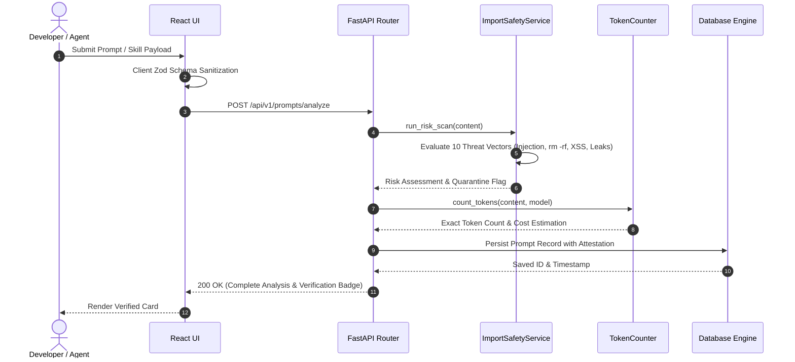

# 🔄 Data Flow & Execution Sequence

## 1. Prompt Ingestion & Safety Lifecycle

Every prompt or tool configuration ingested into Bagback AI Workspace undergoes a deterministic 4-stage pipeline:

---

## 2. Threat Vector Detection Table

| Vector # | Detection Rule | Target Threat Pattern | Action on Trigger |
|---|---|---|---|
| **1** | `promptInjection` | System role overrides & instruction bypasses | Flag for review / quarantine |
| **2** | `ignorePrevious` | "Ignore all previous instructions" directives | Instant quarantine |
| **3** | `stealTokens` | Exfiltration of auth headers or API credentials | Reject & block payload |
| **4** | `credentialExposure`| Plaintext API keys (`sk-...`, `AIzaSy...`) | Mask and quarantine |
| **5** | `rmRf` | Destructive Unix shell commands (`rm -rf /`) | Dangerous flag & quarantine |
| **6** | `curlBash` | Remote pipe-to-shell patterns (`curl ... | sh`) | Dangerous flag & quarantine |
| **7** | `encodedPowerShell`| Obfuscated Base64 PowerShell execution | High severity quarantine |
| **8** | `phishingLinks` | Unverified external domains & credential grabbers | Flag & quarantine |
| **9** | `xssHtmlRisk` | Script tags, raw iframe injections | Sanitize & flag |
| **10** | `unsafeMcp` | Unrestricted MCP tool execution without auth | Enforce sandbox gate |
