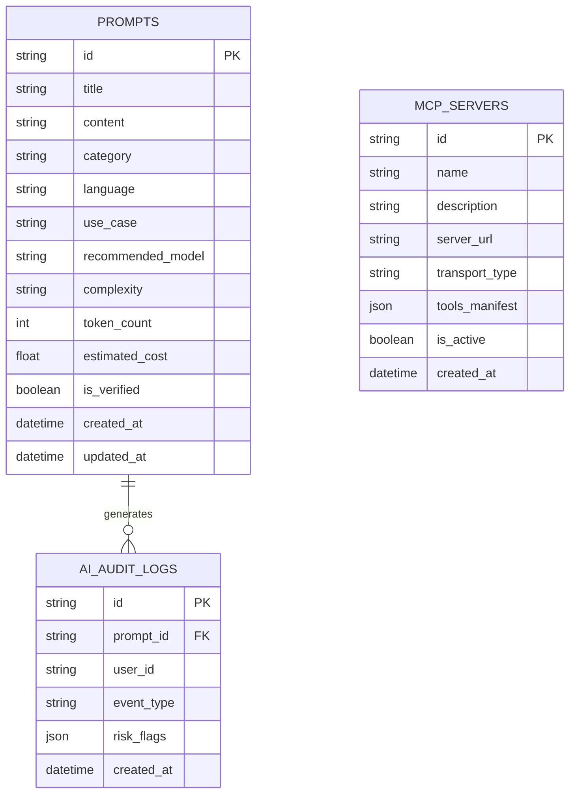

# 🗄️ Database Schema & Data Models

## 1. Relational Entity Models

The application state is persisted using **SQLAlchemy 2.0** ORM mapped across SQLite (development) and Cloud SQL PostgreSQL (production).

---

## 2. Key Table Attributes

### `prompts` Table
- `id`: UUID Primary Key (`crypto.randomUUID()` / `uuid.uuid4()`).
- `title`: Indexed prompt title (bilingual string).
- `content`: Text body containing prompt instructions and variables.
- `token_count`: Pre-computed token consumption via Tiktoken.
- `language`: Detected ISO 639-1 code (`ar` / `en`).
- `estimated_cost`: Computed cost per run in USD based on `recommended_model`.
