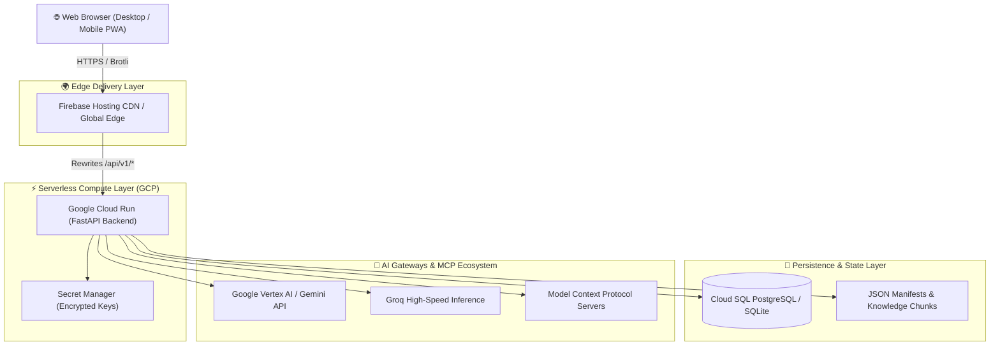

# 🏗️ System Architecture & Infrastructure

## 1. High-Level Architecture Overview

Bagback AI Workspace employs an enterprise-grade, scale-to-zero serverless architecture engineered on **Google Cloud Platform** and **Firebase Hosting**.

---

## 2. Component Specifications

### 2.1 Frontend Container
- **Framework:** React 18 / 19 with TypeScript strict mode.
- **Routing:** React Router DOM (v7.18.3 patched with zero vulnerabilities).
- **Styling & Components:** Tailwind CSS, Lucide Icons, Framer Motion animations.
- **Internationalization:** i18next with bidirectional RTL (Cairo font) & LTR (Plus Jakarta Sans).

### 2.2 Backend Service
- **Runtime:** Python 3.11+ running on Uvicorn + FastAPI.
- **Data Validation:** Pydantic v2 schemas and ORM mapping.
- **Database Engine:** SQLAlchemy 2.0 with Alembic version-controlled migrations.
